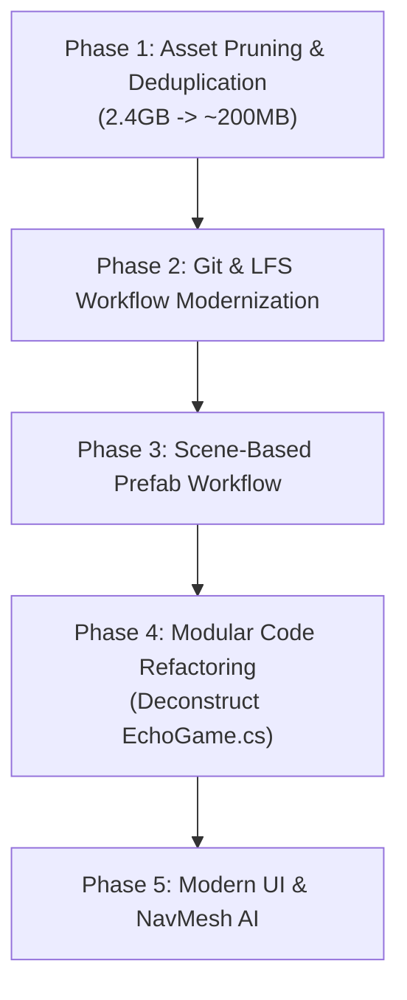

# ECHO: Lost Signal — Technical Specification, Game State & Architecture Plan

---

## 1. Executive Summary & Setting

### 1.1 The Premise & World
**ECHO: Lost Signal** (also titled *ECHO: The Last Signal*) is a first-person atmospheric sci-fi stealth-horror experience set aboard **Deck 03** of an abandoned deep-space orbital research station. 

The player assumes the role of an unnamed **Echo Operator** who awakens alone in the freezing, failing station after a critical catastrophe. The crew is gone, emergency auxiliary power is flickering out, and primary life support systems are severed. 

Outside the station viewports lies a swirling purple-and-cyan aurora nebula, distant planets, and an ominous celestial event horizon: a supermassive black hole with active accretion rings looming in the sector.

The station’s primary reactor has collapsed. To escape, the operator must scavenge three resonance power cells scattered across dark modular decks, reconnect high-voltage reactor leads, align long-range communication relays, and power the evacuation airlock before escaping aboard the **StarSparrow** shuttle.

### 1.2 The Antagonist: "The Listener"
You are not alone on Deck 03. A grotesque bio-mechanical mutant organism known as **The Listener** stalks the corridors. 
- **Sensory Mechanics:** The Listener is nearly blind in the dark station but possesses acute echolocation and auditory sensitivity. 
- **The Core Dilemma:** Deck 03 is pitch black, and the player's flashlight battery drains rapidly (especially through coolant leaks). The player's primary navigation tool is a handheld **Sonar Echo Pulse (Q)**. Firing the pulse sends an expanding ring of light that illuminates bulkheads, reveals hidden paths, and outlines obstacles—**but the acoustic return ping alerts The Listener to your exact coordinates.**
- Every ping is a gamble: illuminate your surroundings to find a power cell or circuit lead, or risk summoning the beast from across the deck.

### 1.3 Narrative & Endings
The narrative is pieced together through scattered crew audio logs, maintenance terminals, and stencil markings on the bulkheads. 
- **Good Ending / The Signal Lives:** The player powers the reactor, aligns all three long-range comms relays (A, B, C), calibrates the rescue carrier frequency array (`3 > 1 > 2`), and transmits the crew's telemetry before fleeing aboard the StarSparrow.
- **Dying Beacon / Uncalibrated Signal:** The player launches the broadcast without proper relay alignment, sending coordinates into the void with no confirmation of rescue.
- **Selfish Ending / Silence, at Last:** The player powers the airlock, ignores the crew's mission, seals the hatch, and escapes alone.
- **Flight Into The Abyss:** The final sequence transitions into manual cockpit flight control of the StarSparrow shuttle, steering through space toward the event horizon.
- **The Dark Found You:** Caught within 1.45 meters of the Listener, resulting in sudden termination.

---

## 2. Current State of the Codebase & Architecture

### 2.1 The "God Script" Problem (`EchoGame.cs`)
The gameplay loop, world construction, rendering hooks, audio logic, AI, player physics, and UI are dominated by a single script: **`Assets/ECHO/Scripts/Echo/EchoGame.cs`** (~2,922 lines of code).

```
Assets/ECHO/Scripts/Echo/EchoGame.cs (2,922 Lines)
├── GameState Finite State Machine (Title, Playing, Puzzle, SignalPuzzle, Choice, Paused, Dead, Ending)
├── Runtime Scene Interceptor ([RuntimeInitializeOnLoadMethod])
├── Procedural Level Builder (BuildStation, BuildModularAnnex, BuildFloorGrid, BuildRoofGrid)
├── Procedural Texture & Material Generator (Nebula Skybox, Lit Materials, Accretion Disks)
├── Hardcoded Waypoint & Route Graph (26 Nodes, 28 Edges, Custom Dijkstra Algorithm)
├── Hardcoded Reactor & Comms Puzzles (Codes 2-3-1 and 3-1-2)
├── Legacy OnGUI Rendering (Title Screen, HUD, Battery Bar, Objective Pointer, Puzzles, Flight GUI)
├── Shuttle Space Flight Simulator (W/A/S/D/Shift/Pitch Physics Engine in space)
├── EchoPlayerMotor Class (Movement, Sprinting, Crouching, Head Bob, Camera Rig)
├── EchoCreature Class (Animation PlayableGraph, Threat Sensing, Patrol, Chase, Respawn)
└── EchoInteractable Trigger System
```

#### How the Game Runs:
1. **Scene Interception:** Rather than building levels within Unity's editor using standard `.unity` scene files, `EchoGame.cs` uses `[RuntimeInitializeOnLoadMethod(RuntimeInitializeLoadType.AfterSceneLoad)]`. Whenever **any** scene loads (e.g., the blank `SampleScene`), `EchoGame` intercepts execution, disables all existing cameras and lights in the scene, and programmatically spawns Deck 03 out of thin air.
2. **Procedural Assembly from Resources:** The station layout, walls, blast doors, windows, decorative props, and lights are instantiated in loops using `Resources.Load<GameObject>("StationKit/...")`.
3. **Procedural Skybox & Materials:** At startup, `BuildNebulaSkybox()` dynamically generates a 512x256 `Texture2D` pixel-by-pixel using nested sine and Perlin noise equations to create the aurora nebula, applying it to a `Skybox/Panoramic` shader.
4. **Custom Echolocation / Pulse System:** 
   - `EchoPulse.cs` fires a mathematical expanding circle via a 96-vertex `LineRenderer` with point lights.
   - Objects tagged with `EchoPulseReveal.cs` have their `Renderer` components toggled off by default and temporarily toggled on when hit by the pulse radius.
5. **Custom Waypoint Navigation instead of NavMesh:** The creature does not use Unity's built-in `NavMesh` or `NavMeshAgent`. Instead, `EchoGame` contains a hardcoded coordinate table of 26 3D nodes (`RouteNodes`) and 28 edges (`RouteEdges`), running an unoptimized Dijkstra shortest-path search each time the creature moves between rooms.
6. **Legacy IMGUI (`OnGUI`):** All user interface elements—including title screens, reticle, interaction prompts, keypad breakers, flight telemetry, and game-over screens—are drawn using Unity's immediate-mode GUI (`OnGUI()`). This triggers multiple GC allocations and draw calls every single frame.
7. **Abandoned Refactor Residue:** Empty folders (`Assets/ECHO/Scripts/Enemy`, `Player`, `Interaction`, and `Player └── PlayerCamera`) demonstrate an initial intention to modularize the code, which was abandoned in favor of cramming everything into `EchoGame.cs`.

---

## 3. The Asset Bloat Crisis: Why the Repository is 2.4+ GB

### 3.1 Folder Size Breakdown
A detailed breakdown of the `Assets/` directory reveals an unsustainable balance between used assets and dead weight:

| Asset Directory / Component | Disk Size | What It Contains | What Is Actually Used |
| :--- | :--- | :--- | :--- |
| **`Assets/Creepy_Cat/`** | **1,173.54 MB** (1.17 GB) | Full 3D Scifi Kit Starter Kit HD (URP/HDRP), dozens of 4K textures, audio loops, demo scenes, 100+ unused meshes | **~15 prefabs** (`Floor_Squared_01`, `DoorWay_01`, `Wall_Cube_01`, `Pipes_01`, `Crate_01`, etc.) |
| **`Assets/MonsterMutant 7/`** | **1,124.16 MB** (1.12 GB) | Full mutant package, 4K skin variations, 12+ FBX attack/hit/death animations, demo scene | **1 model** (`MonsterMutant7 skin1`) and **2 animation clips** (`idle1`, `run1`) |
| **`Assets/Starter Assets/`** | **91.43 MB** | Unity FirstPerson & ThirdPerson controllers, sample models, playgrounds, materials | **0% used** (`EchoGame` has its own handwritten motor) |
| **`Assets/Energy/`** | **32.19 MB** | Multiple battery/cell designs, textures, particle effects, demo scene | **2 prefabs** (`EnergyCell_Type1`, `EnergyCell_Type2`) |
| **`Assets/ECHO/`** | **21.92 MB** | Custom scripts, audio, plus `Resources/StationKit` duplicates | Core game scripts + redundant copies of imported assets |
| **`Assets/StarSparrow/`** | **21.75 MB** | 6 complete spaceship models, alternative paint skins, demo scene | **1 prefab** (`StarSparrow1`) |
| **`Assets/_Recovery/`** | **0.02 MB** | Crash recovery scene files from Unity editor crashes (`0.unity`, `0 (1).unity`, `0 (2).unity`) | **0% used** (pure junk files) |
| **Other (Settings, Icons, etc.)** | **~0.15 MB** | Project configuration, URP pipeline settings, input actions | Active project settings |
| **TOTAL RAW ASSETS** | **~2,443 MB (2.44 GB)** | **Massive binary footprint** | **Less than 100 MB of utilized data** |

```
ASSET FOOTPRINT VISUALIZATION
┌────────────────────────────────────────────────────────┐
│ Creepy_Cat (Modular Station Kit)          1.17 GB (48%)│
├────────────────────────────────────────────────────────┤
│ MonsterMutant 7 (Enemy Model & Anims)     1.12 GB (46%)│
├────────────────────────────────────────────────────────┤
│ Starter Assets (Unused Unity Sample)        91 MB (4%) │
├────────────────────────────────────────────────────────┤
│ Energy Cells + StarSparrow + ECHO Scripts   76 MB (2%) │
└────────────────────────────────────────────────────────┘
```

### 3.2 The `Resources` Duplication Trap (`EchoKitImporter.cs`)
Compounding the 2.4 GB asset problem is `EchoKitImporter.cs`. 
- When run from the editor menu (`ECHO > Import Modular Station Kit`), it copies prefabs, sounds, and animations from `Creepy_Cat`, `MonsterMutant 7`, and `StarSparrow` **into `Assets/ECHO/Resources/StationKit/` and `Assets/ECHO/Resources/MonsterAnimations/`**.
- This means the assets exist **twice** on disk: once in their third-party package folder, and once inside `Resources/`.
- Furthermore, in Unity, **any asset residing in a folder named `Resources` is forcibly baked into the built game package**, bypassing Unity's dead-stripping compiler passes.

---

## 4. The 4-Developer Git Bottleneck: Why the Workflow Sucks

### 4.1 The Version Control Bottleneck
The project is maintained by **4 developers** using Git. Because Unity Version Control (Plastic SCM) requires recurring per-seat subscription costs that are prohibitive for indie/student teams, Git is the mandatory choice. However, the current structure creates severe team friction:

1. **Massive Pushes & Pulls (2GB+ Git LFS Payload):**
   - The `.git` repository folder is already **1.66 GB** locally.
   - Any modification or re-import of textures, FBX files, or prefab dependencies triggers binary delta pushes across Git LFS.
   - Developers spend 15–30 minutes waiting for syncs before they can test a two-line script change.
2. **The "Pull -> Fix -> Push" Lockstep Chain:**
   - Because the entire game is packed into `EchoGame.cs` and procedural dependencies, developers cannot work concurrently on isolated systems (e.g., Developer A tuning Creature AI while Developer B polishes the Flashlight and Developer C designs the Reactor UI).
   - Any branch merge conflicts directly inside `EchoGame.cs` (2,900+ lines) or `SampleScene.unity`.
   - As a result, team members are forced to wait for one person to finish, commit, and push before the next person pulls, tests, and makes their changes.
3. **Scene & Meta File Collisions:**
   - If two developers touch Unity assets in parallel, `.meta` file GUIDs get mismatched or overwriting occurs, causing purple missing-material textures or missing script references.
4. **Git LFS Bandwidth Exhaustion:**
   - Free-tier hosting providers (e.g., GitHub's 1 GB LFS storage / 1 GB monthly bandwidth cap) are instantly overwhelmed by 4 developers pulling a 2.4 GB repository, causing repository lockouts.

---

## 5. Master Remediation Plan: Fixing Git & Modernizing the Codebase

This phased plan outlines how to shrink the repository from **2.4 GB to under 250 MB**, eliminate the version control serialization bottleneck, and refactor the code into a scalable, clean architecture.



---

### Phase 1: Asset Pruning & Deduplication (Immediate ~2.2 GB Reduction)

#### 1.1 Delete Unused Third-Party Bloat
- **Remove `Assets/Starter Assets/` (Save 91.43 MB):** Delete the entire folder. The game uses a custom motor; the First/ThirdPerson playgrounds and armature assets are completely unused.
- **Purge Crash Recovery & Temp Artifacts:** Delete `Assets/_Recovery/`, `Assets/New Folder/`, and `Assets/New Mesh.prefab`.
- **Prune `Creepy_Cat` (Cut ~1.1 GB):**
  - Extract only the **15 modular meshes** referenced in `EchoKitImporter.cs` into `Assets/ECHO/Art/Environment/`.
  - Delete all unused high-resolution demo scenes (`Example_01.unity`), HDRP variant files, and dozens of unused corridor/room meshes.
  - Downscale 4K environment textures (albedo/normal/emission) to 1K or 2K using Unity's platform texture override or Photoshop/GIMP.
  - Delete the original `Creepy_Cat` folder.
- **Prune `MonsterMutant 7` (Cut ~1.05 GB):**
  - Extract `MonsterMutant7 skin1` and the two required FBX animations (`MutantMonster2@idle1.fbx` and `MutantMonster2@run1.fbx`) into `Assets/ECHO/Art/Characters/Monster/`.
  - Delete unused skin variants (Skins 2 through 6), unused FBX animations (`walk2`, `rage`, `attack1`, `attack2`, etc.), and the demo scene.
  - Delete the original `MonsterMutant 7` folder.
- **Prune `Energy` and `StarSparrow` (Cut ~45 MB):**
  - Move `EnergyCell_1_1`, `EnergyCell_2_1`, and `StarSparrow1` to `Assets/ECHO/Art/`.
  - Delete the source asset pack directories and their demo scenes.
- **Eliminate `Resources/` Duplication:**
  - Convert `Resources.Load` calls to direct serialized prefab references in inspector components or Unity ScriptableObject databases.
  - Delete `Assets/ECHO/Resources/` to avoid doubling disk storage and inflating build size.

---

### Phase 2: Git & Version Control Optimization

#### 2.1 Clean the Git History
Because Git preserves every historical commit, simply deleting files locally will **not** reduce `.git` size (currently 1.66 GB).
1. Run `git-filter-repo` or BFG Repo-Cleaner to permanently purge the deleted bloat assets from Git history:
   ```bash
   # Example using BFG to purge large asset directories from history
   bfg --delete-folders "{Creepy_Cat,MonsterMutant 7,Starter Assets}" --delete-files "*.exr"
   git reflog expire --expire=now --all && git gc --prune=now --aggressive
   ```
2. Re-initialize Git LFS tracking strictly for essential binary assets:
   ```gitattributes
   # .gitattributes
   *.fbx filter=lfs diff=lfs merge=lfs -text
   *.png filter=lfs diff=lfs merge=lfs -text
   *.tga filter=lfs diff=lfs merge=lfs -text
   *.wav filter=lfs diff=lfs merge=lfs -text
   *.mp3 filter=lfs diff=lfs merge=lfs -text
   ```

#### 2.2 Branching Model for 4 Developers
Stop working synchronously on `main`. Adopt **Feature-Branch Workflow**:
- `main`: Always playable, stable release build.
- `develop`: Shared integration branch.
- Feature branches (`feature/ai-navmesh`, `feature/reactor-puzzle`, `feature/audio-overhaul`):
  - Each developer works on their dedicated feature branch.
  - Pull requests (PRs) require a quick code review before merging into `develop`.
  - No developer waits on another to push/pull just to test local code.

#### 2.3 Configure Unity YAML Smart Merge (`unityyamlmerge`)
To prevent scene and prefab merge conflicts, configure Git to use Unity's built-in YAML merge tool:
```ini
# In .git/config or global .gitconfig:
[merge]
    tool = unityyamlmerge
[mergetool "unityyamlmerge"]
    trustExitCode = false
    cmd = 'C:\\Program Files\\Unity\\Hub\\Editor\\<UNITY_VERSION>\\Editor\\Data\\Tools\\UnityYAMLMerge.exe' merge -p "$BASE" "$REMOTE" "$LOCAL" "$MERGED"
```

---

### Phase 3: Transition from Runtime Procedural Code to Scene & Prefab Workflow

#### 3.1 Why Runtime Generation Must Go
`EchoGame.cs` builds the entire space station in memory using lines of hardcoded floats (`AddWall(-27f, 20f, 10f, true);`).
- **Disadvantages:** Level designers cannot visually arrange props, place colliders, bake lighting, or adjust room layouts in the Unity Scene View. Every change requires code edits, recompilation, and play-mode execution.
- **Solution:**
  1. Assemble the station layout **once** inside the Unity Editor into a clean scene (`Deck03_Station.unity`).
  2. Create modular room prefabs (`Corridor_Module.prefab`, `ReactorRoom.prefab`, `Hydroponics.prefab`).
  3. Remove `BuildStation()`, `BuildModularAnnex()`, and `[RuntimeInitializeOnLoadMethod]` from scripts.
  4. Allow lighting to be baked with URP Lightmapping and Reflection Probes instead of calculating per-pixel lighting at runtime.

---

### Phase 4: Code Architecture & Decoupling `EchoGame.cs`

Deconstruct the 2,922-line monolithic script into distinct, decoupled systems following the **Single Responsibility Principle (SRP)**:

```
Proposed Architecture:
Assets/ECHO/Scripts/
├── Core/
│   ├── GameManager.cs               // High-level state machine (Title, InGame, Paused, GameOver, Escaped)
│   ├── LevelManager.cs              // Scene loading, respawn coordinates, reset logic
│   └── ObjectiveController.cs       // Tracks cores (3/3), leads (3/3), relays (3/3)
├── Player/
│   ├── EchoPlayerMotor.cs           // CharacterController movement, crouching, sprint, jump
│   ├── EchoPlayerLook.cs            // Mouse yaw/pitch, head bobbing
│   ├── EchoFlashlight.cs            // Battery depletion, coolant leak drain, recharge
│   └── EchoSonarPulse.cs            // Sonar ring expansion, visual reveal, sound ping
├── Enemy/
│   ├── ListenerAI.cs                // State machine: Idle, Patrol, Investigate, Chase
│   ├── ListenerSensory.cs           // Hears Sonar pings, running footsteps, relay carrier tones
│   └── ListenerAnimationController.cs // Mecanim Animator integration (replaces PlayableGraph)
├── Interaction/
│   ├── IInteractable.cs             // Clean C# interface: void Interact(PlayerController player)
│   ├── PowerCellInteractable.cs     // Power core pickup & socket placement
│   ├── ReactorBreakerPuzzle.cs      // 2-3-1 sequence validation
│   ├── CommsCarrierPuzzle.cs        // 3-1-2 signal alignment
│   └── BlastDoorController.cs       // Door slide transitions with audio
├── Audio/
│   ├── SoundManager.cs              // 3D spatial audio, ambient loops, proximity alarms
│   └── StationVoiceAlerts.cs        // "Security Warning", "Proximity Alert" triggers
└── UI/
    ├── UIController.cs              // Canvas-based HUD management
    ├── ReticleView.cs               // Dynamic interaction prompt & reticle tint
    ├── PuzzleModalView.cs           // Keypad / terminal interfaces
    └── EndCardView.cs               // Victory & Death cinematic text cards
```

#### Key Architecture Benefits:
- **Clean Interface Interaction:**
  ```csharp
  public interface IInteractable
  {
      string PromptText { get; }
      void Interact(PlayerController player);
  }
  ```
  Any object (door, battery, note, console) can implement `IInteractable` without modifying the core game manager.
- **Unity NavMesh for The Listener:**
  - Replace the hardcoded `RouteNodes` table with Unity's **NavMeshSurface** and **NavMeshAgent**.
  - Set `NavMeshAgent.destination = player.position` when an acoustic pulse is detected.
  - Allows complex obstacle avoidance, dynamic pathing around crates, and smoother movement.
- **Mecanim Animator over Manual Playables:**
  - Replace low-level `PlayableGraph` code with an Animator Controller containing blend trees for Idle, Walk, and Sprint/Chase.
- **Canvas UI over `OnGUI`:**
  - Migrate from legacy IMGUI to Unity UGUI Canvas with TextMeshPro.
  - Cuts draw calls by 80% and eliminates per-frame garbage collector allocations.

---

## 6. Actionable Implementation Checklist

```markdown
- [ ] 1. ASSET PURGE
  - [ ] Delete `Assets/Starter Assets`
  - [ ] Delete `Assets/_Recovery`, `Assets/New Folder`, `Assets/New Mesh.prefab`
  - [ ] Isolate required FBX/textures from `Creepy_Cat` & delete remainder
  - [ ] Isolate `MonsterMutant7 skin1` + idle/run animations & delete remainder
  - [ ] Downscale 4K textures to 1K/2K URP compressed formats
  - [ ] Run BFG or git-filter-repo to scrub history and shrink .git from 1.66 GB to < 200 MB

- [ ] 2. VERSION CONTROL RESTRUCTURE
  - [ ] Update `.gitattributes` for binary tracking
  - [ ] Create `develop` branch and enforce feature branching for all 4 team members
  - [ ] Configure `unityyamlmerge` on all 4 developer workstations

- [ ] 3. SCENE & LEVEL PREPARATION
  - [ ] Bake the procedural level layout into a dedicated scene: `Assets/ECHO/Scenes/Deck03.unity`
  - [ ] Add NavMeshSurface and bake walkable areas for enemy pathfinding
  - [ ] Remove `[RuntimeInitializeOnLoadMethod]` and procedural instantiation loops

- [ ] 4. CODE REFACTORING
  - [ ] Split `EchoPlayerMotor`, `EchoPlayerLook`, and `EchoFlashlight` out of `EchoGame.cs`
  - [ ] Implement `IInteractable` for power cells, wire leads, puzzles, and airlocks
  - [ ] Convert `ListenerAI` to use `NavMeshAgent` and an Animator Controller
  - [ ] Convert `OnGUI` to Unity Canvas UI + TextMeshPro
```

---

*This specification establishes the official technical baseline, diagnostics, and architectural roadmap for **ECHO: Lost Signal**.*

